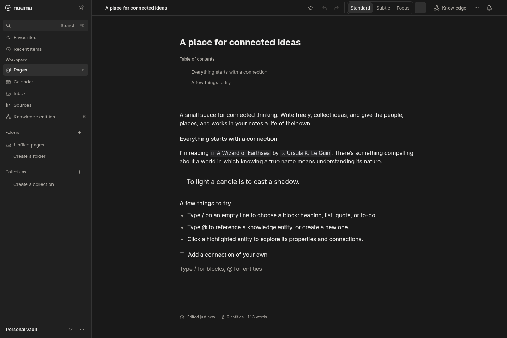
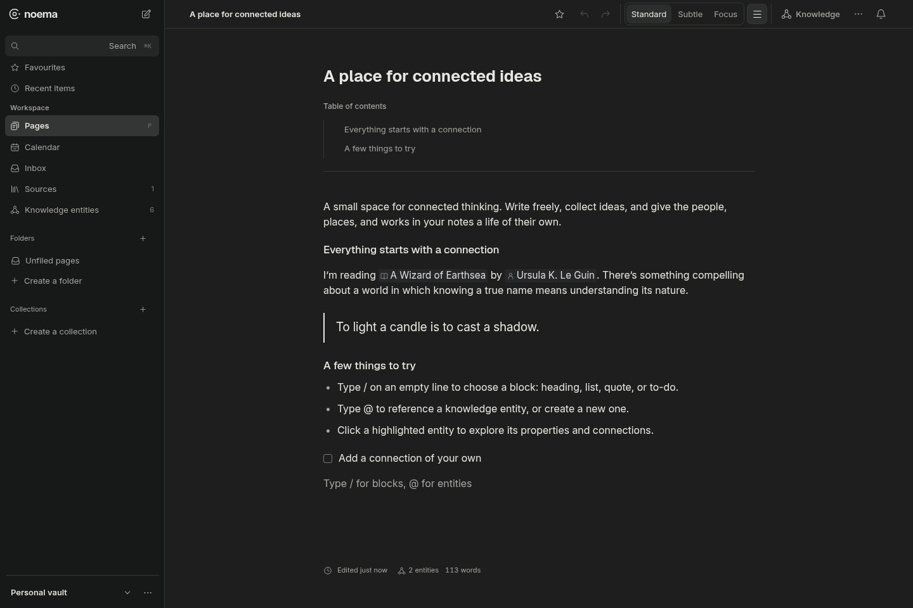
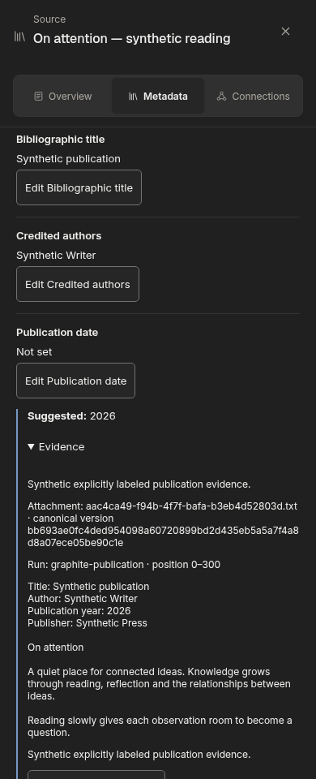
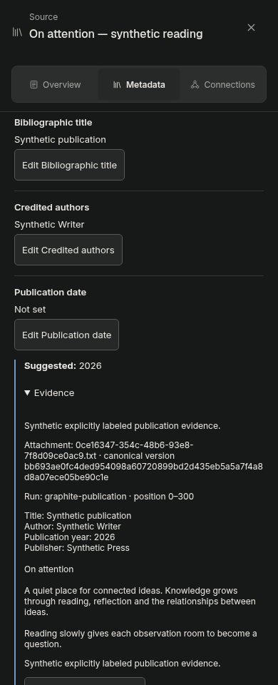

# Quiet Graphite visual pass — 2026-10-24

## Phase 1: current-main baseline

Base: `9b6fecc340be24467eeec3b90b9f762a19e12ccd`, fetched October 24. Historical critique was checked against current source and actual rendered light/dark desktop captures before CSS changes. Current Knowledge is a flat library, not the historical entity-card grid. The visible issues are sidebar and inspector weight, persistent versus transient state hierarchy, and repeated outlined controls. Editor geometry, open document canvas, semantic annotations, accent choices and preference persistence remain in scope to preserve.

`node --import tsx scripts/capture-quiet-graphite.mjs` captures a disposable synthetic vault, blocking external browser requests. Set `PLAYWRIGHT_MODULE` and `CHROMIUM_PATH` for installed browser tools; `NOEMA_SCREENSHOTS` controls the output directory. Defaults cover 1440/390 px, light/dark, Ink/Juniper/Atlantic and Standard/Subtle/Focus. Focus is captured on editor and reader, then exited through the real Escape interaction to reach navigation/overlays. Every capture records effective root presentation attributes; filenames describe initial preference, not a claim that hidden navigation is available in Focus. Captures wait for Knowledge loading labels to disappear. No real vault, secrets or provider calls are used.

Evidence lives in ignored `output/quiet-graphite/` (baseline and final); manifests record exact captures. Screenshot capture is distinct from visual review; the final record identifies reviewed samples and remaining gaps. Illustrative remote references were not used or claimed reviewed.

Independent review is requested for both code and rendered evidence. Essential input boundaries must remain at least 3:1 against their actual surfaces; decorative button borders can be quieter. Light colors and geometry must remain unchanged. Safari requires separate inspection and is unavailable in this Linux environment.

## Implementation phases

- Phase 1 `c6447d7`: current-main audit and reproducible synthetic screenshot harness.
- Phase 2 `dc4d1f2`: dark-only warm-neutral surfaces, recessive navigation, distinct selection/hover and separate decorative button borders. Navigation hover moved to its layout owner and leaves persistent selection intact.
- Phase 3 `2e9e143`: open content surfaces and consistent editor/Knowledge temporary overlays; source excerpt and document-icon fills recede. No editor toolbar or source metadata behavior changed.
- Phase 4 `8c0dbfc`: consistent Library/Calendar selected controls, flatter calendar table/inspector surfaces, structural dialog and palette-menu borders, elevated calendar popovers.
- Validation follow-up `8b87bc9`: relationship-based assertions for dark hierarchy, plus essential boundary contrast against canvas, raised and popover roles. The essential border was retained at `#777a75` (3.07:1 on the brightest popover); decorative labeled buttons use a quieter independent border.

Accents, all six entity palettes, semantic danger/warning/success/info and liturgical colors are untouched. No appearance setting, storage migration, component rewrite, geometry change or new global override layer was introduced. `knowledge.css`, `sources.css`, `editor.css` overlap the named concurrent efforts, but edits affect existing backgrounds/borders only. The published current-main features were incorporated by starting from and re-fetching main, rather than importing unpublished parallel branches.

Production captures: build the pristine baseline and final checkout separately, then set `NOEMA_CAPTURE_PRODUCTION=1`. This avoids repeated development transforms and makes each capture use one stable built artifact. Authoritative evidence directories are `output/quiet-graphite/production-baseline-1440`, `production-baseline-390`, `production-final-1440`, `production-final-390`. Earlier development captures are exploratory and excluded from final coverage. The historical October 23 report in `dark-mode-redesign.md` remains a historical record; this document records the new rendered pass.

## Main integration

Before final validation, fetched and merged `21aef2a` (Entities/Connections and AI pricing updates) as local merge `da9d27e`. The Settings owner merged cleanly; no parallel hooks or behavior were overwritten. The new Connect picker gets a single dark-only pressed-filter role change in its own `connect-picker.css`, preserving its exact light fill. The capture harness now includes settled properties, the grouped Connections view and the open Connect picker. Integrated validation and screenshots use separately built `21aef2a` baseline and merged final checkouts; earlier images remain explicitly earlier evidence.

Independent review covered the complete visual CSS diff and representative actual desktop/mobile Chromium pairs: editor, Knowledge panel/library, entity properties, Sources/reader, Pages Library, Calendar, Settings, menu/dialog, all three accents and Standard/Subtle/Focus reading samples. It found no blocking code or visual defect. The initial essential-boundary concern was corrected; loading property captures were replaced by settled supplemental images. The later dark-only Connect picker change was independently reviewed without findings. New integrated Connections screenshots remain part of final validation.

The first full suite on the initial base had 1,331 tests: 1,320 passed, four failed, seven skipped under simultaneous browser load. The four failing files (speech transport, Calendar preload, navigation UI, source reprocessing concurrency) then passed all 65 tests when rerun serially. No application behavior or tests were changed to conceal these timing failures. A fresh full suite on integrated main is run with browser workers stopped.

## Integrated validation record

`npm run build` passed after integrating main and the small Connect picker adjustment: CSS ownership/literal budgets, application and test typechecks, server compilation and production bundle. The existing bundle-size advisory remains.

`npm run test:all` on integrated main: **1,353 tests, 1,346 passed, zero failed, seven skipped**. The full run was completed with browser workers stopped; no further full runs are needed for unchanged implementation. Six skips require macOS/native platform tooling; the optional Kokoro voice synthesis integration is also skipped. The cloud dependency install used `npm ci --ignore-scripts` after the optional ONNX GPU download failed DNS resolution; no speech/model downloads or paid calls were used.

Final browser scripts support `NOEMA_BROWSER_PRODUCTION=1` for the built real-app matrix; the dense synthetic reading-marker fixture continues using Vite. Navigation startup gets a 60-second budget in the dark harness while its existing interaction/contrast/accessibility assertions remain unchanged. Browser captures use separately built baseline/final assets with external requests blocked.

Final evidence uses `output/quiet-graphite/integrated-baseline-{1440,390}` and `integrated-final-{1440,390}`. Each completed manifest records the base/revision, rendering mode, browser and effective presentation attributes per capture. The local `output/quiet-graphite/review.html` gallery compares matched images. Earlier production/dev directories are exploratory or earlier-base evidence and are not the integrated matrix.

`test:dark-mode` and `test:design` both passed all 12 desktop/mobile × light/dark × accent cases in Chromium `154.0.8037.57`, with zero page errors. Minimum checked status/entity text contrast: **5.59:1**. Coarse-pointer dense-marker grouping and 200% CSS zoom checks also passed. The dark harness intentionally captures no screenshots; rendered evidence comes from the separate capture matrix and design harness. The existing out-of-month light Calendar hover pair remains 4.4376:1; this dark-only pass preserves it.

The capture-only harness tolerates slow cloud startup and can resume complete image sets via `NOEMA_CAPTURE_RESUME=1`. Resumed PNGs are retained rather than rerendered; manifests mark them `resumed` with null presentation measurements, rather than inventing computed observations. Incomplete configuration sets are captured in full. Three capture workers hit interaction timeouts under parallel load in both baseline and final; resumable capture completes the gaps without changing application code or weakening browser assertions. The final 12-case dark/design checks passed independently.

## Final rendered coverage and handoff

The integrated matrix is complete: **36 configurations per revision × 13 screens = 468 PNGs per revision, 936 total**, at 1440×960 and 390×960. Both modes, all three accents and Standard/Subtle/Focus initial preferences are represented. The 13 screens are editor, Knowledge panel/library, settled entity overview, Connections, Connect picker, Sources, source reader, Pages Library, Calendar, Settings, page menu and rename dialog. Focus reading screenshots are taken before Escape; navigation/overlays are reached after restoration. Manifests distinguish effective presentation where measured. Of 936 PNGs, 234 complete earlier images were preserved through resume and are explicitly marked without new measurements. Capture is exhaustive for this matrix; human visual inspection is representative, covering every screen family and accent/presentation choice, rather than every image individually.

Light comparison: 230 of 234 original baseline/final light pairs are pixel-identical. Three differences occupy only two narrow 2px strips and one single pixel; the fourth is an asynchronous Knowledge loading state. A narrowly scoped supplemental baseline/final capture (`settled-panel-{baseline,final}`) waits for actual settled text and is pixel-identical. The harness now waits for the exact settled state instead of mismatching ellipsis punctuation; the review gallery uses that settled pair. The original captures are retained. No light palette or geometry declarations changed.

Independent review found no blocking code or visual findings, including all 12 matched integrated entity/Connections/picker images. Reading hierarchy, density and legibility were compared against actual rendered light/dark surfaces; the historical critique and illustrative remote images were not treated as proof. Existing mobile Settings “Appearance” label wrapping is unchanged. Safari and native browser UI zoom remain unreviewed; Chromium and CSS zoom do not establish Safari parity.

Deliverables: `review.html`, `coverage.json`, `light-comparison.json`, `contrast.json`, four integrated capture directories, the settled-panel pair and `validation/` logs under ignored `output/quiet-graphite/`. At the initial local handoff, all implementation changes were committed on `codex/quiet-graphite-dark`; no push, PR, merge to main or deployment had been performed. The new Unified Alerts & Notifications effort is independent: no notification behavior, notice aliases or `notifications.css` were changed. Its token additions should preserve this branch’s dark surface values, accent/entity palettes and semantic status roles. Shared Settings changes from main merged cleanly; future token edits are the main integration touchpoint.

## Draft publication follow-up — latest main

Integrated actual latest main `a0667a7` as merge `1939da4`, including editor toolbar #100, source metadata #101, settings refresh #103 and source simplification #102. Toolbar, metadata and settings-refresh behavior/hooks are unchanged by this branch. Their owning CSS merged cleanly; the new metadata CSS remains byte-identical to main. Independent code and representative visual review found no regression in current desktop/mobile Standard/Subtle/Focus controls, menu, metadata, uncertainty/evidence states or source workspace.

Post-integration `npm run build` passed (styles, application/test types, server and client). Ninety affected tests passed with zero failures: toolbar menu, settings session/refresh, metadata domain/provenance/UI, reader refresh, reprocessing, entity property/panel, navigation and semantics. The earlier 1,353-test full run and 936-image matrix are retained as earlier-base evidence; unchanged work was not regenerated. The PR CI runs the full suite on its exact published head.

A narrow supplement compares built main `a0667a7` against the integrated branch: 28 PNGs per revision for current editor Standard/Subtle/Focus, menu, source workspace Overview, metadata and expanded evidence at desktop/mobile in light/dark, plus four dedicated prose-reader PNGs per revision with the inspector closed. These **64 current-base images** are under `output/quiet-graphite/publication-{baseline,final}` and `publication-prose-{baseline,final}`. The source-workspace image on mobile shows Overview, not prose; dedicated `source-prose` captures establish the mobile reading surface. Twelve of 14 initial light pairs are pixel-identical; the two expanded-evidence differences contain different disposable fixture UUIDs. Metadata/status meaning remains distinct from accent.

The fresh design and dark-mode checks both passed all 12 cases on Chromium 154.0.8037.57, with zero page errors and minimum checked status/entity text contrast 5.59:1. A source virtualizer can replace a passage between a visibility wait and later computed sampling; the helper now atomically collects rendered samples and composited colors before retaining the same strict non-empty/contrast assertions. Independent review confirmed this synchronization does not bypass checks. Safari remains pending; these are Chromium results, with representative human inspection, not a cross-browser parity claim.

### Representative current-base images

All content is synthetic. These small committed examples make the draft reviewable without publishing the full capture matrix.

| Latest main, dark | Quiet Graphite, dark |
| --- | --- |
|  |  |
|  |  |

[Unchanged light editor reference](quiet-graphite/editor-light-reference.png).
